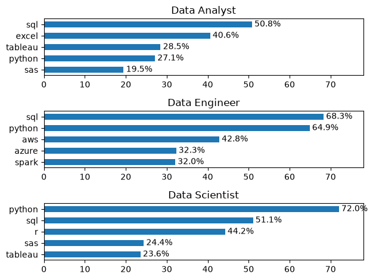
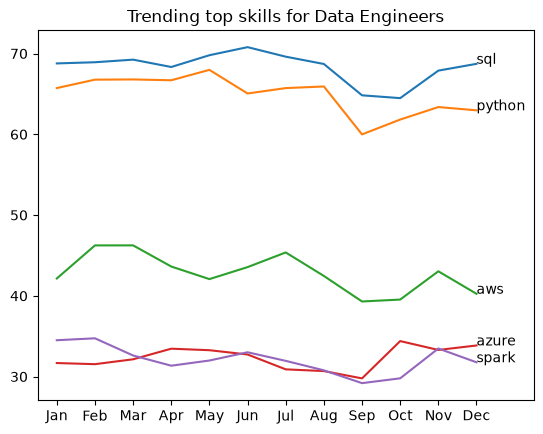

# Analysis

## 1. What are the most demanded skills for top 3 data roles?

To find the most demanded skills for the top 3 data roles, I filtered out the positions which were most popular and got the top 5 skills for these top 3 roles. This query highlights the most popular job titles and their top skills.

View the jupyter notebook:
[2_Skills_count.ipynb](2_Skills_count.ipynb)

### Visualising the data:
``` python
fig, ax = plt.subplots(len(job_titles), 1)

for i, job_title in enumerate(job_titles):
    df_plot = df_skills_percentage[df_skills_percentage['job_title_short'] == job_title].head()
    df_plot
    df_plot.plot(kind='barh', x='job_skills', y='percentage', ax=ax[i], title= job_title)
    ax[i].bar_label(ax[i].containers[0], fmt='%.1f%%', padding=3)
    ax[i].set_ylabel('')
    ax[i].invert_yaxis()
    ax[i].legend().set_visible(False)
    ax[i].set_xlim(0, 78)

fig.tight_layout()
```

### Result



### Insights

- Python is the most demanded skill across all 3 roles expecially for Data Scientists(72%) and Data Engineers(65%).
- SQL is the most demanded skill for Data Analysts and one of the top skills for Data Engineers and Data Scientists.
- Data Engineers required more cloud technical skill(like AWS, Azure) and Spark.

## 2. How are in-demand skills trending for Data Engineers

### Visualising the data:
``` python
fig, ax = plt.subplots()

for skill in df_plot.columns:
    ax.plot(df_plot.index, df_plot[skill], label=skill)

    ax.text(
        df_plot.index[-1],
        df_plot[skill].iloc[-1],
        skill
    )
plt.title('Trending top skills for Data Engineers')
ax.set_xlim(-0.5, len(df_plot.index) + 0.5)
ax.legend().remove()
```

### Result



### Insights

- SQL and Python are the 2 top in demand skills for Data Engineers
- AWS is the leading cloud provider establishing a slight margin over Azure
- Most skills see a sharp recovery in the October, November months